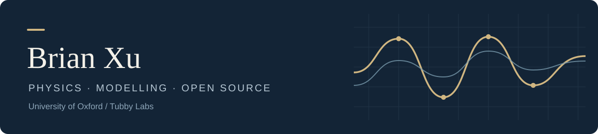

  

  <a href="https://github.com/tubby-labs-research/tubby-quant">Tubby Quant</a>
  &nbsp; · &nbsp;
  <a href="https://github.com/tubby-labs-research">Tubby Labs</a>

I'm Brian, a physics student at the **University of Oxford**. I enjoy using mathematical models to understand real-world behaviour, and building tools to test those models against data.

### Building · Tubby Quant

I lead **[Tubby Quant](https://github.com/tubby-labs-research/tubby-quant)** with a small team of students at Oxford and Cambridge. It's an Apache-2.0 Python framework for quantitative research and backtesting.

- **Research:** price/volume data and SEC fundamentals, with fast factor screening.
- **Validation:** Qlib-backed backtests and reports for exploring selected strategies in more detail.
- **Workflow:** AI agents help with research and development, with human direction, review and testing.

We're building towards a comprehensive open-source research and trading platform for small hedge funds. Our current focus is daily US equities.

  <a href="https://github.com/tubby-labs-research/tubby-quant"><strong>Explore the project →</strong></a>

### A little background

Tubby Labs grew out of our WorldQuant International Quant Championship team, where we developed agent-assisted workflows for generating and testing factors. My physics research has involved modelling the electrical behaviour of quantum-dot LEDs.

I like projects where mathematical reasoning, useful software and careful experiments meet.
